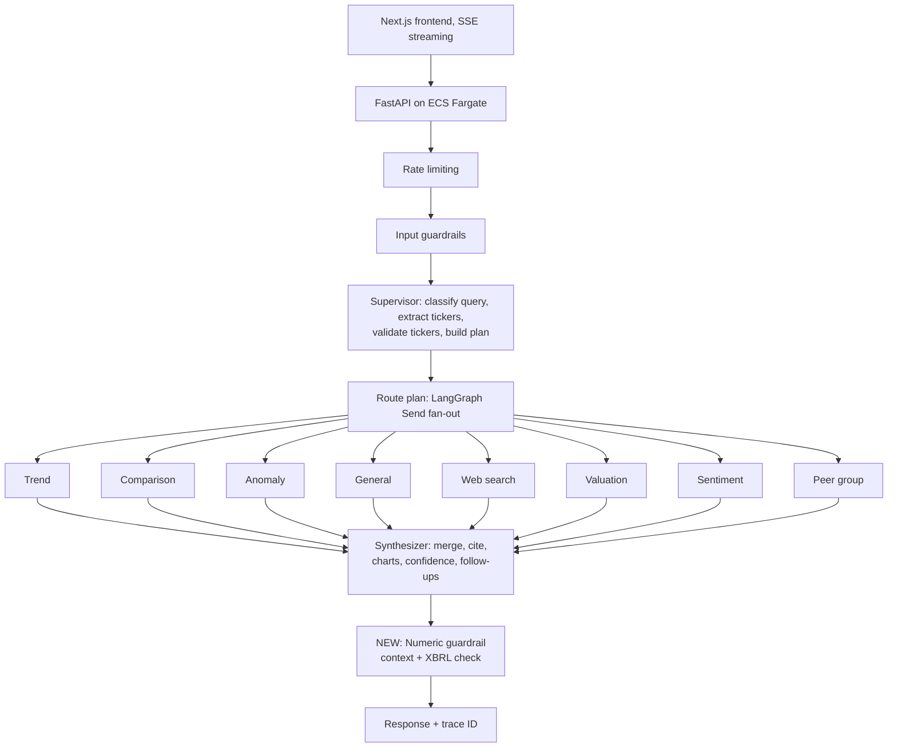
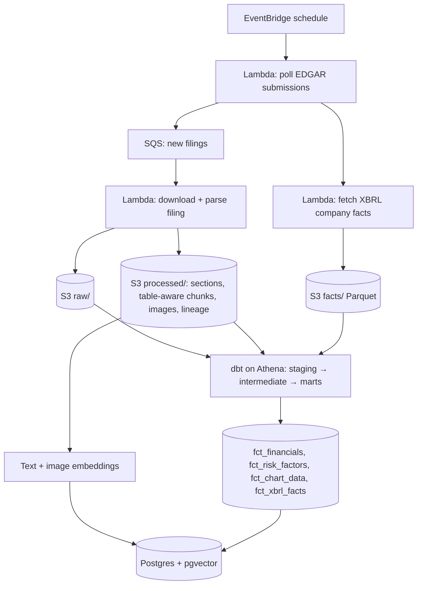

# Accession

**Every answer, traced to its filing.**

Accession (formerly [SecSignal](https://github.com/ghantasala-sr/SecSignal)) is a multi-agent RAG system for SEC financial intelligence. It analyzes trends, compares companies, scores sentiment, and flags anomalies across 10-K and 10-Q filings. Every SEC filing has a unique accession number. Accession traces every answer back to one: which filing, which section, which chunk, and whether each number in the answer is actually supported.

> **Status:** In development. This project is a migration of SecSignal from Snowflake Cortex + GCS to AWS. The multi-agent architecture is preserved; the platform underneath it changes, and the system is redesigned around evaluation, tracing, and data lineage. No results are reported until they've been measured on a held-out eval set.

---

## Why migrate

<!-- TODO (Rithik): replace with your real reasons. Delete any that don't apply.
- Cost: Snowflake trial/credits, cost per query
- Control: needed full traces of every agent step for trace-based evals
- Lock-in: LLM, search, embeddings, and parsing were all tied to Cortex
- Lineage: needed chunk-level metadata and time-versioned XBRL facts
- Consolidation: storage on GCS, compute on Snowflake, serving on Render/Vercel
-->

SecSignal worked in demos and failed on a question I hadn't written myself: it retrieved the right filing, cited the right section, and returned a number that appeared nowhere in the filing. Accession keeps everything SecSignal does, and adds the tracing, lineage, and numeric verification needed to find and catch that failure.

---

## Migration map

| Concern | SecSignal (before) | Accession (after) |
|---|---|---|
| Raw storage | GCS bucket | S3 (`raw/`, `processed/`, `facts/`) |
| Ingestion scheduling | Airflow weekly DAG | EventBridge schedule → SQS → Lambda |
| Warehouse | Snowflake RAW schema | S3 Parquet + Athena; Postgres for serving tables |
| Transforms | dbt on Snowflake | dbt on Athena (staging → intermediate → marts preserved) |
| LLM calls | `CORTEX.COMPLETE()` | Provider interface (Bedrock or direct API) |
| Semantic search | Cortex Search | Postgres + pgvector, plus Postgres full-text for hybrid search |
| Text embeddings | Arctic embed (1024d) | Configurable embedding provider (re-embed required) |
| Image embeddings | Voyage multimodal-3 | Voyage API directly |
| Document parsing | `AI_PARSE_DOCUMENT()`, `AI_EXTRACT()` | Textract or an open-source parser (decide in Phase 2) |
| Web search | Cortex Agent (`AGENT_RUN`) | Web search API behind the same tool interface |
| Agents | LangGraph supervisor + 8 specialists + synthesizer | **Unchanged** (only tool implementations swap) |
| Backend hosting | Render | ECS Fargate |
| Frontend | Next.js on Vercel | Next.js on Vercel (unchanged) |
| Tracing | OpenTelemetry middleware | OpenTelemetry, extended to every agent and tool call |
| Evals | `evaluation/` module | Same module, used as the parity baseline, then extended |

**Migration principle:** the agents don't know which platform they run on. Every platform-specific call (LLM, search, SQL, embeddings, web search) goes behind an interface in `accession/providers/`, so the agent code ports with minimal changes and parity can be tested layer by layer.

---

## Agent architecture (preserved from SecSignal)



| Agent | Responsibility |
|---|---|
| Supervisor | Query classification, ticker extraction and validation, execution plan |
| Trend | Single-company time-series analysis |
| Comparison | Multi-company side-by-side comparison |
| Anomaly | Z-score anomaly detection over rolling windows |
| General | Open-ended financial questions |
| Web search | Real-time data and unknown tickers, clearly attributed |
| Valuation | P/E, margins, growth-implied multiples, basic DCF |
| Sentiment | MD&A and risk factor tone scoring |
| Peer group | Sector peer identification and benchmarking |
| Synthesizer | Merges agent outputs into a cited answer with charts and confidence |

---

## Data pipeline (AWS)



---

## What's new beyond the migration

1. **Event-driven ingestion.** New filings are picked up automatically instead of on a weekly batch schedule.
2. **Lineage on every chunk.** Each chunk carries its accession number, form type, section, fiscal period, and units. Chunking is table-aware, so a table is never separated from its header.
3. **XBRL as ground truth.** Tagged financial figures are stored as structured facts, so numbers in answers can be checked automatically against official values.
4. **Restatement-aware answers.** Facts are stored with both their fiscal period and the date they were filed, so the system can answer "as originally reported" or "as currently reported" when a company amends a filing (e.g., 10-K/A).
5. **Full agent traces.** Every answer's trace ID links the supervisor's plan, each specialist's tool calls and outputs, the synthesizer's prompt, the guardrail verdict, latency, and cost.
6. **Numeric guardrail.** Numbers in the synthesized answer are verified against retrieved context and XBRL facts before the response is returned. The fine-tuned judge for this is built separately as **Footnote**.
7. **Evals as a gate.** The eval suite runs in CI and blocks regressions.

---

## Tech stack

| Layer | Choice |
|---|---|
| Language | Python 3.12, managed with `uv` |
| Agents | LangGraph (StateGraph + Send) |
| API | FastAPI + SSE, slowapi rate limiting |
| Frontend | Next.js (App Router), shadcn/ui, Recharts (ported from SecSignal) |
| Serving DB | Postgres + pgvector (RDS), SQLAlchemy 2.x + Alembic |
| Storage | S3, Parquet |
| Transforms | dbt (Athena adapter) |
| Analytics | Athena; DuckDB locally |
| Ingestion | EventBridge, SQS, Lambda |
| Serving | ECS Fargate (backend), Vercel (frontend) |
| Tracing | OpenTelemetry; LangSmith for agent traces |
| Infra | Terraform |
| Testing | pytest, moto, docker compose Postgres |
| CI | GitHub Actions: lint, tests, eval gate |
| Lint/format | ruff, mypy |

---

## Data sources

All data comes from SEC EDGAR's free public APIs. Starter set (same as SecSignal): AAPL, AMZN, GOOGL, MSFT, NVDA, TSLA.

| Data | Endpoint |
|---|---|
| Filing history per company | `https://data.sec.gov/submissions/CIK##########.json` |
| All XBRL facts per company | `https://data.sec.gov/api/xbrl/companyfacts/CIK##########.json` |
| One concept over time | `https://data.sec.gov/api/xbrl/companyconcept/CIK##########/{taxonomy}/{tag}.json` |
| Filing documents | `https://www.sec.gov/Archives/edgar/data/{cik}/{accession_no_dashes}/` |

**SEC fair access rules (required):**
- Send a declared `User-Agent` header with your name and email (`SEC_USER_AGENT`).
- Stay at or below 10 requests per second, enforced by a rate limiter in the client.
- Cache everything in S3. Never re-download a filing you already have.

---

## Data model (serving tables)

```
companies       (cik PK, ticker, name, sic_code)
filings         (accession_number PK, cik FK, form_type, filed_date,
                 period_of_report, is_amendment, amends_accession_number)
sections        (id PK, accession_number FK, item, title, order)
chunks          (id PK, accession_number FK, section_id FK, chunk_type [text|table|image],
                 table_header, fiscal_period, units, text, embedding vector, tsv tsvector)
images          (id PK, accession_number FK, section_id FK, s3_key, description, embedding vector)
xbrl_facts      (id PK, cik FK, accession_number FK, taxonomy, tag, units, value,
                 period_start, period_end, fiscal_year, fiscal_period, form_type, filed_date)
traces          (trace_id PK, question, query_type, plan, created_at,
                 final_output, guardrail_verdict, confidence_score,
                 total_latency_ms, total_cost_usd)
trace_spans     (span_id PK, trace_id FK, parent_span_id, node [supervisor|agent|tool|synthesizer|guardrail],
                 name, input, output, model, latency_ms, input_tokens, output_tokens, cost_usd)
```

**Restatements:** a fact is identified by `(cik, tag, period_start, period_end)`. Multiple rows can exist with different `filed_date` values. "As originally reported" = earliest `filed_date`; "as currently reported" = latest.

---

## Repository structure

```
accession/
├── README.md
├── CLAUDE.md
├── pyproject.toml
├── docker-compose.yml
├── .env.example
├── accession/
│   ├── config.py
│   ├── providers/              # platform interfaces: llm, embeddings, search, sql, web_search
│   │   ├── base.py
│   │   └── aws/                # AWS implementations
│   ├── agents/                 # ported from SecSignal
│   │   ├── graph.py
│   │   ├── state.py
│   │   ├── supervisor.py
│   │   ├── trend_agent.py
│   │   ├── comparison_agent.py
│   │   ├── anomaly_agent.py
│   │   ├── general_agent.py
│   │   ├── web_search_agent.py
│   │   ├── valuation_agent.py
│   │   ├── sentiment_agent.py
│   │   ├── peer_group_agent.py
│   │   ├── synthesizer.py
│   │   ├── guardrails.py       # input guardrails
│   │   └── tools/
│   ├── edgar/                  # EDGAR client, rate limiter, submissions, XBRL
│   ├── ingest/                 # parsing, table-aware chunking, images, lineage
│   ├── embed/
│   ├── db/                     # SQLAlchemy models, session
│   ├── numeric_guardrail/      # claim extraction + context/XBRL verification
│   ├── tracing/
│   └── api/
├── frontend/                   # ported Next.js app
├── dbt/                        # ported dbt project, Athena adapter
├── lambdas/
├── migrations/                 # Alembic
├── evals/
│   ├── baseline/               # saved SecSignal outputs (parity reference)
│   ├── datasets/               # questions split by company
│   ├── graders/
│   ├── run_eval.py
│   └── parity/
├── infra/                      # Terraform
└── tests/
```

---

## Migration phases

### Phase 0: Capture the SecSignal baseline (do this first)
- [ ] Run SecSignal's existing evaluation suite while Snowflake access is still available
- [ ] Save every question, final answer, sources, agent outputs, charts, confidence score, and latency to `evals/baseline/`
- [ ] Record the baseline scores from SecSignal's scorers
- [ ] Without this, migration parity cannot be proven

### Phase 1: Provider interfaces
- [ ] Define interfaces for LLM, embeddings, semantic search, SQL, and web search in `accession/providers/base.py`
- [ ] Port SecSignal's agents and tools to call the interfaces instead of Cortex directly
- [ ] Agents should run against mock providers in tests

### Phase 2: Ingestion and storage
- [ ] EDGAR client with declared User-Agent, rate limiter (≤10 req/s), retries with backoff
- [ ] Ingest the 6 starter tickers into the S3 layout (locally first)
- [ ] Section parsing, table-aware chunking, image extraction, lineage metadata
- [ ] Choose the document parser (Textract vs open source) and record the decision
- [ ] XBRL company facts to Parquet

### Phase 3: Transforms and serving data
- [ ] Port the dbt project to the Athena adapter; preserve staging → intermediate → marts
- [ ] Add `fct_xbrl_facts`
- [ ] Postgres + pgvector schema via Alembic; load chunks, images, and embeddings
- [ ] Hybrid search: pgvector + Postgres full-text

### Phase 4: Agents on AWS + full tracing
- [ ] AWS provider implementations
- [ ] Every supervisor decision, agent run, and tool call written as a span
- [ ] FastAPI + SSE streaming working with the ported frontend

### Phase 5: Parity
- [ ] Run the same eval questions through Accession
- [ ] Compare against `evals/baseline/`: answer quality, source attribution, chart relevance, factual accuracy, latency, cost
- [ ] Investigate every regression before moving on
- [ ] Document results honestly, including anything that got worse

### Phase 6: New features
- [ ] Numeric guardrail: context check + XBRL check, per-claim verdicts with evidence
- [ ] Restatement-aware answers
- [ ] Interface for the Footnote judge
- [ ] Eval gate in GitHub Actions

### Phase 7: AWS deployment
- [ ] Terraform: S3, SQS, Lambda, EventBridge, RDS, ECS Fargate, Athena, IAM, CloudWatch
- [ ] AWS Budgets alerts at $50 / $100 / $150
- [ ] One-command teardown (`terraform destroy`)
- [ ] CloudWatch metrics: latency, cost per query, guardrail flag rate

---

## Evaluation

Metrics are reported only after running on the held-out split.

| Metric | What it measures |
|---|---|
| Parity vs SecSignal | Same questions, scored by the same scorers, before vs after |
| Numeric accuracy vs XBRL | Numbers in answers match the official tagged value |
| Unsupported-claim recall | Share of unsupported numbers the guardrail catches |
| Citation validity | Cited accession number and section contain the supporting text |
| Retrieval hit rate | The chunk containing the answer was retrieved |
| Routing accuracy | Supervisor sends the query to the right specialist agents |
| Latency (p50 / p95) | End-to-end response time |
| Cost per query | Model + infrastructure cost |

---

## Local development

```bash
cp .env.example .env          # set SEC_USER_AGENT="Your Name your@email.com"
docker compose up -d          # Postgres + pgvector
uv sync
uv run alembic upgrade head
uv run pytest
uv run accession AAPL AMZN GOOGL MSFT NVDA TSLA   # fetch, parse, chunk, validate, dbt build
uv run uvicorn accession.api.main:app --reload
cd frontend && npm install && npm run dev
```

---

## Cost guardrails

- Postgres + pgvector on a small RDS instance instead of OpenSearch Serverless (which has a minimum capacity charge).
- Athena is pay-per-scan; partition facts by `cik` and `fiscal_year`.
- EventBridge + Lambda instead of managed Airflow, which has a fixed hourly cost.
- Check whether promotional credits cover the chosen Bedrock model. Third-party models billed through AWS Marketplace may not be covered.
- Tear down dev infrastructure when not in use.

---

## Non-goals

- Not investment advice. Answers describe what filings report.
- Not a real-time trading or market data system.
- No scraping beyond SEC's public APIs and archives.

---

## Related

- **SecSignal**: the original Snowflake Cortex version.
- **Footnote**: fine-tuned judge for unsupported numbers in financial RAG answers (separate repo).
- **Ship It, Then Prove It**: LinkedIn series documenting this build.

## License

MIT
