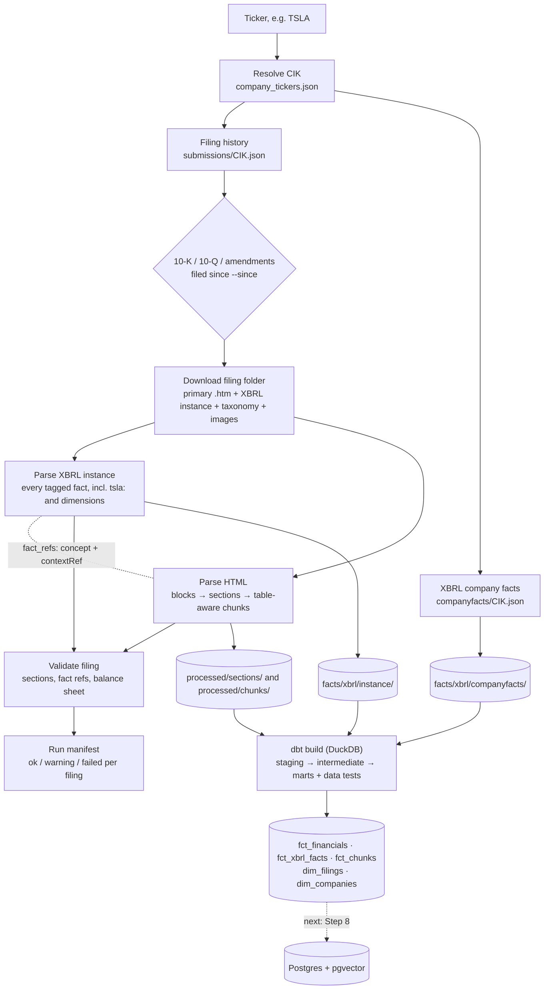
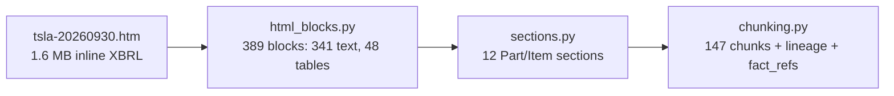
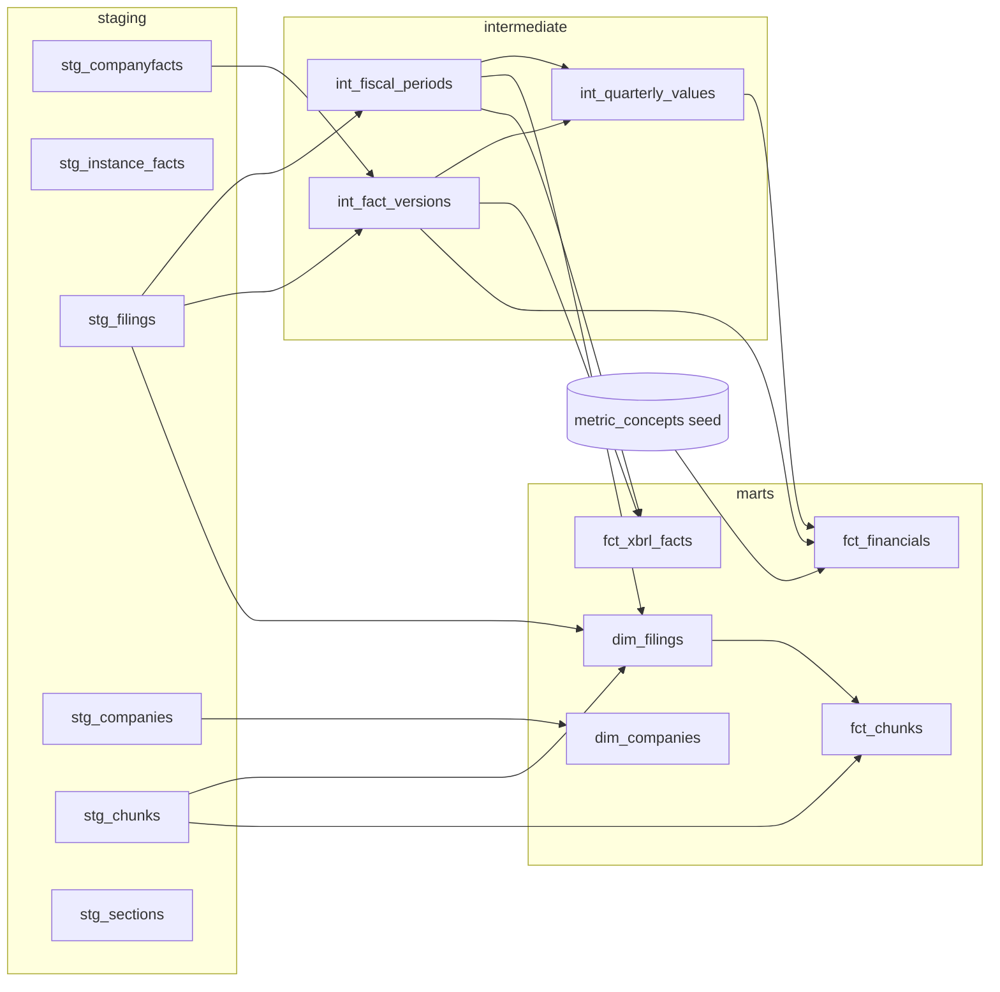

# Accession

**Every answer, traced to its filing.**

Accession is a multi-agent RAG system for SEC financial intelligence, rebuilt from [SecSignal](https://github.com/ghantasala-sr/SecSignal) around evaluation, tracing, and data lineage. Every SEC filing has a unique accession number; Accession traces every answer back to one: which filing, which section, which chunk, and whether each number in the answer is supported by the company's own XBRL-tagged figures.

> **Status: data layer built, agents not yet.** Ingestion, parsing, chunking, validation, and the dbt marts run end to end for the six starter companies. Postgres + pgvector, the agents, the numeric guardrail, and the eval suite come next (see [Roadmap](#roadmap)). No answer-quality results are reported until they've been measured on a held-out eval set.

---

## Contents

- [Quick start](#quick-start)
- [The data flow at a glance](#the-data-flow-at-a-glance)
- [Stage by stage](#stage-by-stage)
  - [1. SEC EDGAR client](#1-sec-edgar-client)
  - [2. Ticker → CIK](#2-ticker--cik)
  - [3. Filing history](#3-filing-history)
  - [4. XBRL company facts](#4-xbrl-company-facts)
  - [5. Filing documents](#5-filing-documents)
  - [6. XBRL instance](#6-xbrl-instance)
  - [7. HTML → blocks → sections → chunks](#7-html--blocks--sections--chunks)
  - [8. Validation and the run manifest](#8-validation-and-the-run-manifest)
  - [9. dbt transforms](#9-dbt-transforms)
- [Following one number end to end](#following-one-number-end-to-end)
- [Storage layout](#storage-layout)
- [Table reference](#table-reference)
- [What the data taught us](#what-the-data-taught-us)
- [Data quality checks](#data-quality-checks)
- [Running and re-running](#running-and-re-running)
- [Repository layout](#repository-layout)
- [Roadmap](#roadmap)

---

## Quick start

```bash
cp .env.example .env        # set SEC_USER_AGENT="Your Name your@email.com"
uv sync
uv run accession TSLA AAPL AMZN GOOGL MSFT NVDA
```

That one command fetches, downloads, parses, chunks, validates, and transforms every 10-K and 10-Q (and amendments) filed since 2023 for the given tickers. Any ticker SEC knows works: `uv run accession COST`.

A first run for the six starter companies takes about 2½ minutes (it is bound by SEC's rate limit) and produces:

| Output | Count |
|---|---|
| Filings processed and validated | 97 (97 ok, 0 failed) |
| Raw files cached from EDGAR | 882 files, 670 MB |
| XBRL facts (companyfacts, full history) | 162,268 |
| XBRL facts (filing instances, incl. custom + dimensional) | 111,221 |
| Sections | 1,363 |
| Chunks (16,185 text, 6,233 table) | 22,418 |
| Fiscal quarters on the calendar | 575 |
| Rows in `fct_financials` (16 metrics × periods × 2 bases) | 12,836 |

Re-running only does new work: finished filings are skipped and SEC documents are never downloaded twice.

---

## The data flow at a glance



Three ideas run through the whole pipeline:

1. **XBRL is the source of truth for numbers.** Financial figures come from the company's own tagged facts, never from an LLM reading text. (SecSignal extracted every metric with an LLM from MD&A prose, which is how it ended up citing a number that appeared nowhere in the filing.)
2. **Every row carries lineage.** Each chunk knows its accession number, form, section, fiscal period, units, and the exact XBRL facts it displays.
3. **Everything is validated as it is produced.** A filing that parses badly is flagged, not silently loaded.

---

## Stage by stage

Storage keys below are relative to `DATA_DIR` (default `./data`), which is a local stand-in for an S3 bucket with the same `raw/`, `processed/`, `facts/` layout.

### 1. SEC EDGAR client

**Code:** [`accession/edgar/client.py`](accession/edgar/client.py)

Every request to SEC goes through one client that follows SEC's [fair access rules](https://www.sec.gov/os/accessing-edgar-data):

- **Declared User-Agent** from `SEC_USER_AGENT`. Config refuses to start without a contact email.
- **Rate limiter** spacing requests at 8/s (SEC's ceiling is 10/s), shared across threads.
- **Retries** on 429 and 5xx with exponential backoff, honouring `Retry-After`.
- **Cache-first.** Every response is written to the object store under an S3-shaped key before it is returned. Archive documents are immutable, so they are fetched once, ever. Index endpoints (submissions, company facts, ticker map) change as companies file, so the runner refreshes those on each run.

The object store is [`accession/storage.py`](accession/storage.py): `LocalStore` writes files atomically (write, then rename) under `DATA_DIR`. An `S3Store` with the same three methods (`exists`, `get`, `put`) replaces it on AWS.

### 2. Ticker → CIK

**Code:** [`accession/edgar/submissions.py`](accession/edgar/submissions.py) (`resolve_tickers`)
**Source:** `https://www.sec.gov/files/company_tickers.json` → `raw/edgar/company_tickers.json`

SEC identifies companies by CIK, not ticker. The ticker map resolves `TSLA` → `0001318605`. CIKs are always kept as 10-digit zero-padded strings, end to end. If a ticker isn't in the cached map (a new listing), the runner refreshes the map once.

### 3. Filing history

**Code:** [`accession/edgar/submissions.py`](accession/edgar/submissions.py) (`fetch_submissions`)
**Source:** `https://data.sec.gov/submissions/CIK##########.json`
**Output:** `raw/edgar/submissions/CIK….json` (+ older history pages), `processed/edgar/filings/CIK….jsonl`

The submissions document stores filings **column-wise**: `filings.recent` holds parallel arrays (`accessionNumber[i]`, `form[i]`, `filingDate[i]`, `reportDate[i]`, `primaryDocument[i]`, …) for about the latest 1,000 filings, and `filings.files` points to older pages with the same layout. We follow every page, keep only `10-K`, `10-Q`, `10-K/A`, `10-Q/A`, and write one JSON line per filing with its document URL.

For Tesla, 1,000 recent filings shrink to 26 10-Qs: most of the rest are Form 4 insider trades, 8-Ks, and proxy materials.

> The accession number's prefix is the **filer agent**, not the company: Tesla's 10-Qs start `0001628280` (Workiva) and its 10-K/A starts `0001104659` (Toppan Merrill). Filings are always tied to companies by CIK.

### 4. XBRL company facts

**Code:** [`accession/edgar/xbrl.py`](accession/edgar/xbrl.py)
**Source:** `https://data.sec.gov/api/xbrl/companyfacts/CIK##########.json`
**Output:** `facts/xbrl/companyfacts/cik=<CIK>/facts.parquet`

SEC's companyfacts API returns every standard-taxonomy fact a company has ever filed, nested as `facts[taxonomy][tag].units[unit] → [fact, …]`. We flatten it to one row per fact per filing, **without interpreting it**:

| Column | Meaning |
|---|---|
| `taxonomy`, `tag`, `label`, `unit` | e.g. `us-gaap`, `CashAndCashEquivalentsAtCarryingValue`, `USD` |
| `value` | raw units: dollars, not millions |
| `period_type`, `period_start`, `period_end`, `duration_days` | instants have no start (balance sheet); durations do (income/cash flow) |
| `accession_number`, `form_type`, `filed_date` | which filing reported it |
| `filing_fiscal_year`, `filing_fiscal_period` | **the filing's** labels, not the fact's (see below) |
| `frame` | SEC's pick of one canonical row per calendar period |

What this data does and doesn't contain shaped everything downstream:

- **`fy`/`fp` label the filing, not the period.** Tesla's Q3 2026 10-Q labels its December 2025 comparatives `fy=2026, fp=Q3`. The columns are renamed `filing_fiscal_*` so nobody mistakes them for the period's own fiscal year.
- **Facts repeat.** Cash at 2025-12-31 appears four times (the 10-K and three later 10-Qs). 59% of rows have no `frame`. We keep every copy, because the filing dates are what restatement-aware answers need.
- **There is no Q4.** Filings report the year and nine months year-to-date; Q4 must be derived.
- **No custom or dimensional facts.** Tesla's `tsla:` tags and every segment/product/geography breakdown are missing. Those come from the filing's own instance (stage 6).

The Parquet files are Hive-partitioned by `cik=`, and `cik` is not repeated as a column inside the file: Athena rejects a partition key that is also a data column (we found this the first time we read the dataset back).

### 5. Filing documents

**Code:** [`accession/edgar/filing_docs.py`](accession/edgar/filing_docs.py)
**Source:** `https://www.sec.gov/Archives/edgar/data/<cik>/<accession-no-dashes>/index.json`
**Output:** `raw/edgar/filings/<CIK>/<accession>/…`

A filing folder holds ~90 files. We download 6–9 of them:

| Kept | Why |
|---|---|
| Primary document (`tsla-20260930.htm`) | the filing itself, inline XBRL HTML |
| XBRL instance (`*_htm.xml`, or a standalone `.xml` before 2019) | every tagged fact with contexts |
| Extension schema + linkbases (`.xsd`, `_cal`, `_def`, `_lab`, `_pre`) | the company's custom concepts, labels, statement structure |
| `FilingSummary.xml` | SEC's map of the statements |
| Images (`.jpg`, `.png`, `.gif`) | charts, for later image processing |

Skipped: SEC's rendered `R*.htm` pages, exhibits, and the `.txt`/`.zip` bundles.

### 6. XBRL instance

**Code:** [`accession/edgar/instance.py`](accession/edgar/instance.py)
**Output:** `facts/xbrl/instance/cik=<CIK>/accession=<accession>/facts.parquet`

The instance is the complete set of facts the filing tagged. Tesla's Q3 2026 10-Q has **1,259** of them, the same count the SEC inline viewer shows. Unlike companyfacts, it keeps:

- **Company extension concepts**, e.g. `tsla:LeasedAssetsNet` (energy generation and storage systems, $4,453M).
- **Dimensional facts**, e.g. revenue on `srt:ProductOrServiceAxis` (automotive $20,560M, energy $2,881M, services $4,605M) or by country. About half of all numeric facts carry a dimension.

Each fact becomes one row: `concept` (`prefix:LocalName`), `context_id`, period, `dimensions` (a list of `{axis, member}`; **empty means the consolidated, face-of-statement value**), `unit` (`USD`, `shares`, `USD/shares`), `decimals`, `value` (already scaled), and `value_text` for non-numeric facts. Identical repeats (a filing shows the same fact wherever it's displayed) are collapsed: that 10-Q's 1,259 tagged facts become 1,150 rows. Text blocks are flagged but their HTML content is dropped; the primary document is the source of narrative text.

Two dei facts in the instance matter for amendments: `AmendmentFlag` (which Tesla mis-tags as `false` on its own 10-K/A) and `DocumentFinStmtErrorCorrectionFlag`, the reliable restatement signal on 10-K cover pages.

### 7. HTML → blocks → sections → chunks

**Code:** [`accession/ingest/`](accession/ingest/)
**Output:** `processed/sections/<CIK>/<accession>.parquet`, `processed/chunks/<CIK>/<accession>.parquet`



**Blocks** ([`html_blocks.py`](accession/ingest/html_blocks.py)). Filer agents generate deeply nested, inline-styled `<div>`s. We walk the DOM and emit a text block for each innermost block element and a table block for each `<table>`:

- Page artifacts (page numbers, the "Table of Contents" link after every `<hr>`) and the TOC table itself are dropped. The hidden `ix:header` is skipped.
- Table cells are collapsed: SEC puts `$`, `(`, `)`, `%` in their own cells, so `$ | 17,853` becomes `$17,853` and `( | 117 | )` becomes `(117)`. Header rows (leading rows with an empty label column) are aligned; group labels like "Assets" stay in the body.
- One-row tables shaped `| Item 2. | Management's Discussion… |` are headings, not tables (Amazon lays out every heading this way).
- Every `ix:nonFraction` inside a block is recorded as a **fact ref** (`concept`, `contextRef`), plus its `scale` (6 → millions). Cover-page `dei:` facts give the registrant, document type, and fiscal year/period focus.

Blocks hold 98.9% of the document's text; the rest is the dropped TOC and page furniture.

**Sections** ([`sections.py`](accession/ingest/sections.py)). Two SecSignal bugs, fixed structurally:

1. The table of contents repeats every Item heading. Real headings are text blocks outside tables, TOC entries live inside a `<table>`, so headings are only detected in text blocks. This held for every filer agent in the starter set.
2. A 10-Q has Part I *and* Part II, and both contain "Item 1" and "Item 1A". Sections are keyed by `(part, item)` (`part1_item1`, `part2_item1`), never by item alone. A missing PART heading is inferred from item numbering (10-Q) or the item number itself (10-K items are unique).

A heading must be short and bold or upper-case, so body text such as "Item 1A of our Annual Report describes…" is not mistaken for one. Each section gets a form-independent `section_kind`, so agents can ask for `mda` without knowing it's Item 7 in a 10-K and Item 2 in a 10-Q.

**Chunks** ([`chunking.py`](accession/ingest/chunking.py)):

- Chunks never cross a section boundary or subheading. Consecutive bold lines ("Tesla, Inc." / "Consolidated Balance Sheets" / "(unaudited)") are one subheading.
- **Text chunks** pack whole paragraphs up to 2,000 characters; only a single longer paragraph is split, at sentence boundaries.
- **A table is its own chunk, with its caption**: the short lines just above it, e.g. *"Tesla, Inc. Consolidated Balance Sheets (in millions, except per share data) (unaudited)"*. Units come from the caption, falling back to the XBRL scale. A table longer than 6,000 characters is split by rows, and **every piece repeats the caption and column headers**, so no number is ever separated from its header.
- Every chunk carries full lineage and an `embed_text`: the chunk prefixed with company, form, period, section, and subheading, which is what will be embedded for retrieval.

### 8. Validation and the run manifest

**Code:** [`accession/ingest/validate.py`](accession/ingest/validate.py), [`accession/run.py`](accession/run.py)
**Output:** `processed/manifests/CIK….json`

Every filing is checked the moment it is processed:

| Check | Severity | Catches |
|---|---|---|
| Required sections present (10-Q: financial statements, MD&A; 10-K: business, risk factors, MD&A, financial statements; amendments exempt) | error | headings not detected |
| No empty chunks | error | parser emitting blanks |
| Every chunk `fact_ref` resolves to a fact in the instance | error | lineage broken |
| Assets = Liabilities + Equity on every balance sheet date | error | wrong or mis-scaled facts |
| Unknown section kinds, headings seen twice | warning | worth a look |

Results go into a per-company manifest: status, parser version, section/chunk/fact counts, and issues, saved after every filing so an interrupted run keeps its progress. One failing filing is recorded and the run moves on; the command exits 1 if anything failed.

This caught a real bug on the first full run: **all 16 Amazon filings failed** with "missing financial_statements, mda", because Amazon lays out headings as one-row tables. Without validation they would have loaded as single-section filings and quietly degraded retrieval.

### 9. dbt transforms

**Code:** [`dbt/`](dbt/) (dbt on DuckDB locally; Athena in Phase 7)
**Output:** `data/accession.duckdb`

`uv run accession` runs `dbt build` after ingesting (skip with `--no-transform`). All file reads go through one macro ([`dbt/macros/store.sql`](dbt/macros/store.sql)), so switching to Glue tables over S3 changes one file.



**`int_fiscal_periods`: each company's fiscal calendar.** Built from filing *structure*, not XBRL labels: each 10-K's period end closes a fiscal year (Q4), and the 10-Qs between two year ends are Q1–Q3 in order. The year's number is the calendar year it ends in, plus the company's naming offset, decided by majority vote over its 10-Ks. Labels can't be trusted: NVIDIA tagged its FY2011 quarters "2010 Q2, Q3, Q3", which gave one fiscal quarter two end dates until the calendar stopped relying on them. The result handles Apple's 52/53-week year (Q1 FY2026 = 2025-09-28 to 2025-12-27), Microsoft's June year end, and NVIDIA's January year end with its 14-week quarters.

**`int_fact_versions`: every report of every fact.** A fact is `(cik, taxonomy, tag, unit, period_start, period_end)`. Each report is a version, flagged:

- `is_primary_report`: reported by the filing whose own period it is (a quarter in its 10-Q, a year in its 10-K, not an amendment). This is **as originally reported**. The first XBRL appearance is *not*: periods from before a company adopted XBRL were first tagged as comparatives in later, sometimes restated, filings (Apple FY2009).
- `is_current`: the latest report. This is **as currently reported**.
- `is_restated`: the fact was reported with more than one value (3,537 current facts, about 4%).

**`int_quarterly_values`: standalone quarters, on both bases.** Filings often don't report a standalone quarter, so values are derived and labelled:

| `derivation` | When |
|---|---|
| `reported` | the filing reported the quarter directly |
| `ytd_difference` | cash flow statements in 10-Qs are year-to-date only: Q2 = 6M − 3M, Q3 = 9M − 6M |
| `annual_minus_nine_months` | always used for Q4: the audited year minus nine months, even when a 10-K's supplementary quarterly table tags a Q4 value, because that table is where tagging errors show up |

**`fct_financials`: 16 core metrics from XBRL.** Revenue, cost of revenue, gross profit, R&D, operating income, net income, EPS (basic, diluted), diluted shares, operating cash flow, capex, cash, total assets, liabilities, equity, liabilities + equity. The [`metric_concepts`](dbt/seeds/metric_concepts.csv) seed maps each metric to tags in priority order, because companies tag the same thing differently (revenue is `Revenues` for NVIDIA and Alphabet, `RevenueFromContractWithCustomerExcludingAssessedTax` for Apple, Microsoft, Amazon). Every row has a `basis` (`original` or `current`), the `tag` used, its `derivation`, and its `source_accession`. Non-additive metrics (EPS, share counts) only ever use reported quarters: subtracting year-to-date EPS is meaningless.

This table replaces SecSignal's `EXTRACTED_FINANCIALS`, which an LLM extracted from MD&A text.

---

## Following one number end to end

Tesla's cash and cash equivalents at September 30, 2026: **$17,853 million**.

| Step | Where it lives | What it looks like |
|---|---|---|
| Filing | `tsla-20260930.htm`, Part I Item 1 balance sheet | `<ix:nonFraction name="us-gaap:CashAndCashEquivalentsAtCarryingValue" contextRef="c-3" scale="6">17,853</ix:nonFraction>` |
| Instance fact | `facts/xbrl/instance/cik=0001318605/accession=0001628280-26-066775/` | `concept=us-gaap:CashAndCashEquivalentsAtCarryingValue`, `context_id=c-3`, `period_end=2026-09-30`, `dimensions=[]`, `value=17853000000` |
| Chunk | `processed/chunks/0001318605/0001628280-26-066775.parquet` | `chunk_id=0001628280-26-066775:part1_item1:0000`, caption "Consolidated Balance Sheets (in millions…)", text row `\| Cash and cash equivalents \| $17,853 \| $16,513 \|`, `fact_refs` includes `(us-gaap:CashAndCashEquivalentsAtCarryingValue, c-3)` |
| Company facts | `facts/xbrl/companyfacts/cik=0001318605/` | same value, plus every other filing that reported it |
| Mart | `fct_financials` | `ticker=TSLA, metric=cash_and_equivalents, fiscal_year=2026, fiscal_period=Q3, value=17853000000, source_accession=0001628280-26-066775` |

When an answer cites that chunk, the numeric guardrail (coming) can check "$17.9 billion" against the exact fact the filing displayed: its period, its dimensions, its units. The same works for rows companyfacts doesn't have at all: the balance sheet's "Operating lease vehicles, net" ($4,047M) is `us-gaap:DeferredCostsLeasingNetNoncurrent` with the `tsla:OperatingLeaseVehiclesMember` dimension, reachable only through the instance. Across the Q3 10-Q, all 1,037 distinct fact refs on chunks resolve.

---

## Storage layout

```
data/                                         # DATA_DIR; mirrors the S3 bucket
├── raw/edgar/                                # exactly what SEC returned
│   ├── company_tickers.json
│   ├── submissions/CIK##########.json        # + CIK…-submissions-NNN.json history pages   (2.6 MB)
│   ├── companyfacts/CIK##########.json                                                       (23 MB)
│   └── filings/<CIK>/<accession>/            # index.json, .htm, _htm.xml, .xsd, linkbases, images  (670 MB)
├── facts/xbrl/                               # flattened XBRL, Hive-partitioned Parquet
│   ├── companyfacts/cik=<CIK>/facts.parquet                                                  (1 MB)
│   └── instance/cik=<CIK>/accession=<accession>/facts.parquet                                (2.6 MB)
├── processed/
│   ├── edgar/filings/CIK##########.jsonl     # periodic filings with document URLs
│   ├── sections/<CIK>/<accession>.parquet                                                    (6.3 MB)
│   ├── chunks/<CIK>/<accession>.parquet                                                      (13 MB)
│   └── manifests/CIK##########.json          # per-filing status, counts, issues
└── accession.duckdb                          # dbt warehouse (local)                         (86 MB)
```

`raw/` is never modified after it is written. Everything under `facts/` and `processed/` can be regenerated from `raw/` without contacting SEC (`uv run accession … --no-refresh --force`).

---

## Table reference

**`processed/chunks` / `fct_chunks`** (one row per chunk)

| Column | Example |
|---|---|
| `chunk_id` | `0001628280-26-066775:part1_item1:0000` |
| `cik`, `ticker`, `accession_number`, `form_type`, `filed_date`, `period_of_report` | `0001318605`, `TSLA`, … |
| `fiscal_year_focus`, `fiscal_period_focus` (from the filing) / `fiscal_year`, `fiscal_period` (from the calendar, in `fct_chunks`) | `2026`, `Q3` |
| `section_key`, `section_kind`, `section_title`, `subheading` | `part1_item1`, `financial_statements`, … |
| `chunk_type` | `text` or `table` |
| `table_caption`, `table_header`, `units` | `Consolidated Balance Sheets …`, `September 30, 2026 December 31, 2025`, `millions` |
| `fact_refs` | list of `{concept, context_id}` displayed in the chunk |
| `text`, `embed_text` | chunk text; text prefixed with company/form/period/section for embedding |

**`fct_financials`** (one row per basis, company, metric, fiscal period)

| Column | Example |
|---|---|
| `basis` | `original` (as filed for that period) or `current` (as most recently reported) |
| `ticker`, `metric`, `fiscal_year`, `fiscal_period` | `TSLA`, `revenue`, `2025`, `Q4` |
| `period_start`, `period_end` | `2025-10-01`, `2025-12-31` |
| `value`, `unit` | `24901000000`, `USD` |
| `tag`, `derivation`, `source_accession` | `Revenues`, `annual_minus_nine_months`, `0001628280-26-003952` |

Flows have `Q1`–`Q4` and `FY`; balance sheet stocks have `Q1`–`Q4` (the Q4 value is the year-end balance).

**`fct_xbrl_facts`** (every reported version of every companyfacts fact) adds the fact's own fiscal labels (`fiscal_period` is `Q1`–`Q4`, `FY`, `H1`, or `9M`), `period_kind`, `version`, `times_reported`, `is_original`, `is_current`, `is_restated`, and the original and current values with their filing dates.

---

## What the data taught us

Each of these was found by running the pipeline on real filings, and each is now handled in code:

| Finding | Example | Handled in |
|---|---|---|
| `fy`/`fp` label the filing, not the period | Q3 2026 10-Q labels Dec 2025 comparatives "2026 Q3" | renamed `filing_fiscal_*`; calendar built separately |
| Filers mis-tag their own fiscal periods | NVIDIA FY2011 quarters tagged "2010 Q2, Q3, Q3" | `int_fiscal_periods` uses filing structure + majority vote |
| An amendment isn't a restatement | Tesla's yearly 10-K/A is Part III only: 0 financial facts, `AmendmentFlag=false` | amendments exempt from section checks; restatements come from fact versions |
| companyfacts omits custom and dimensional facts | Tesla lease vehicles, energy systems; all segment revenue | instance parsing (stage 6) |
| The same metric uses different tags | revenue: `Revenues` vs `RevenueFromContractWithCustomer…` | `metric_concepts` seed with priorities |
| PP&E isn't where you'd look | Tesla uses `PropertyPlantAndEquipmentAndFinanceLeaseRightOfUseAsset…` | instance facts keep every concept |
| There is no Q4, and 10-Q cash flows are YTD-only | Tesla FY2025 revenue 94,827 − 9M 69,926 = Q4 24,901 | `int_quarterly_values` derivations |
| "Latest value" can mix accounting bases | Microsoft restated FY2016 for ASC 606; its FY2016 quarters never were | two bases in `fct_financials` |
| Later comparatives carry tagging errors | Amazon's FY2012 10-K tagged Q4 2011 revenue as Q4 2012 | Q4 always from the audited year minus nine months |
| The TOC repeats every heading | every filing | headings only from text blocks outside tables |
| 10-Q Part I and Part II share item numbers | Item 1 = Financial Statements and Legal Proceedings | sections keyed by `(part, item)` |
| Filer agents lay out headings differently | Amazon: one-row heading tables | heading-table detection |
| Fiscal calendars differ | Apple 52/53-week, Microsoft June, NVIDIA January | fiscal labels everywhere, never calendar quarters |

---

## Data quality checks

**At ingest** (per filing, recorded in the manifest): see [stage 8](#8-validation-and-the-run-manifest). All 97 starter filings pass.

**In dbt** (`dbt build` runs them after every model):

| Test | What it asserts |
|---|---|
| keys | unique/not-null on companies, filings, chunks; unique fiscal quarter per company and per period end; unique `fct_financials` row per basis/company/metric/period |
| relationships | every `fct_financials.source_accession` is a known filing; every chunk belongs to a filing |
| accepted values | form types, fiscal quarters 1–4, derivation labels |
| `assert_balance_sheets_balance` | total assets = liabilities + equity on every balance sheet date, both bases |
| `assert_quarters_sum_to_year` | Q1 + Q2 + Q3 + Q4 = FY for revenue, net income, operating income, operating cash flow, capex, as originally reported, fiscal 2019 onward |
| `assert_known_filing_values` | spot values read directly off filings (Tesla's total assets, cash, revenue, derived Q4) |
| `warn_quarters_sum_to_year` (warning) | the same sum check for every year and both bases, listed for review |

The warning currently lists 10 known filer-side issues, all in fiscal 2011–2017: within-year revisions in early XBRL years (0.06–1.8%), Microsoft's ASC 606 restatement on the current basis, and Amazon's FY2012 tagging error on the current basis. They're reported, not hidden, and they don't fail the build.

**Unit tests:** `uv run pytest` (49 tests: client rate limiting and retries, parsing fixtures copied from real Tesla and Amazon filings, chunking, validation, runner selection and skip logic). `uv run ruff check . && uv run mypy` for lint and strict typing.

---

## Running and re-running

```bash
uv run accession TSLA AAPL                      # default: 10-K, 10-Q + amendments filed since 2023-01-01
uv run accession NVDA --since 2020-01-01        # more history
uv run accession MSFT --forms 10-K              # annual reports only
uv run accession TSLA --force                   # reprocess filings already done
uv run accession TSLA --no-refresh              # offline: use cached filing history and facts
uv run accession TSLA --no-transform            # skip the dbt build
uv run accession TSLA -v                        # log every SEC request (to stderr)
```

- **Skipping.** A filing is skipped when its manifest entry is `ok` or `warning`, was produced by the current `PARSER_VERSION` ([`accession/ingest/pipeline.py`](accession/ingest/pipeline.py)), and its chunks exist. Bump `PARSER_VERSION` when parsing output changes and the next run reprocesses everything.
- **Failures** are retried on every run until they pass.
- **dbt by hand:** `uv run dbt build --project-dir dbt --profiles-dir dbt` (from the repo root).
- **Exploring:** `uv run python -c "import duckdb; print(duckdb.connect('data/accession.duckdb').sql('select * from fct_financials limit 5'))"`

---

## Repository layout

```
accession/
├── config.py              # settings from .env (SEC_USER_AGENT, DATA_DIR, rate limit)
├── storage.py             # ObjectStore protocol, LocalStore (S3Store later)
├── run.py                 # `uv run accession`: the one entry point
├── edgar/
│   ├── client.py          # rate-limited, retrying, cache-first SEC client
│   ├── submissions.py     # ticker → CIK, filing history
│   ├── xbrl.py            # companyfacts → Parquet
│   ├── filing_docs.py     # selective filing-folder download
│   └── instance.py        # XBRL instance → Parquet (custom + dimensional facts)
└── ingest/
    ├── html_blocks.py     # DOM → text/table blocks with fact refs
    ├── sections.py        # blocks → Part/Item sections
    ├── chunking.py        # sections → table-aware chunks with lineage
    ├── pipeline.py        # one filing → sections + chunks tables; PARSER_VERSION
    └── validate.py        # per-filing checks
dbt/
├── models/staging/        # views over the store
├── models/intermediate/   # fiscal calendar, fact versions, quarterly values
├── models/marts/          # dim_*, fct_*
├── seeds/metric_concepts.csv
├── tests/                 # singular data tests
└── macros/                # store readers, test helpers
tests/                     # pytest
CLAUDE.md                  # full project plan: architecture, migration phases, evals
```

---

## Roadmap

Built (Phases 2–3 of [CLAUDE.md](CLAUDE.md)): EDGAR client, ingestion, XBRL facts, table-aware chunking with lineage, validation, the single runner, and the dbt marts.

Next:

1. **Postgres + pgvector** (Phase 3): load `fct_chunks` and `fct_financials`, embed `embed_text`, hybrid search (vector + full text).
2. **Agents on the provider interfaces** (Phases 1, 4): port SecSignal's supervisor, specialists, and synthesizer; tools query `fct_financials` instead of LLM-extracted metrics.
3. **Numeric guardrail** (Phase 6): verify every number in an answer against the cited chunk's `fact_refs` and XBRL facts.
4. **Evals** (Phases 0, 5): SecSignal's saved outputs were never captured, so parity means the same questions and scorers; the primary user is a fundamental equity analyst, with other personas as eval dimensions.
5. **AWS** (Phase 7): `S3Store`, Glue + Athena for dbt, Lambda/SQS ingestion with a shared rate limiter, RDS, Bedrock, Fargate.

Not yet handled: images downloaded with filings are not described or embedded; linkbases (statement labels and ordering) are stored but not parsed; dimensional facts are in `stg_instance_facts` but not yet in a mart; `amends_accession_number` is not linked.

---

## Data source and fair use

All data comes from SEC EDGAR's free public APIs and archives. The client declares a User-Agent, stays under 10 requests per second, and caches everything so nothing is downloaded twice. Not investment advice: answers describe what filings report.

## License

MIT
